# Online Department Store Management System – Bài làm hai module

> Đề bài: [question.md](question.md). MSSV: B23DCAT280.
> Module 1 – **Customer tracks invoice** (`Track Invoice 0`). Module 2 – **Sale staff approves orders + export** (`Approve and Export Order 0`).
> Quy ước: tên use case bằng tiếng Anh, kết thúc bằng số 0. Tất cả biểu đồ là PlantUML trong [diagrams/src/](diagrams/src/), xuất ảnh bằng `python3 export_diagrams.py`.
> Dữ liệu mẫu (khách Nguyễn Văn An, đơn DH1024, nhân viên giao hàng GH03…) được dùng xuyên suốt từ kịch bản tới CSDL ([sql/system_sample_data.sql](sql/system_sample_data.sql)) và được kiểm thử tự động bằng `python3 verify.py`.

**Mục lục:** [Q1](#question-1) · [Q2](#question-2) · [Q3](#question-3) · [Q4](#question-4) · [Q5](#question-5) · [Phụ lục](#phụ-lục--phân-tích-hoạt-động-bổ-sung)

---

## Question 1

### 1a. Biểu đồ use case

**Biểu đồ tổng quan.** System Member có Login 0 / Logout 0 / Change Password 0; Customer, Management Staff và Sale Staff kế thừa System Member. Hai use case tô màu là hai module của đề bài. Delivery Staff **không** là actor: theo đề bài họ không thao tác trên hệ thống, chỉ là đối tượng được Sale Staff chọn và nhận hàng ngoài phần mềm (Delivery Staff vẫn là một lớp thực thể ở Q2).

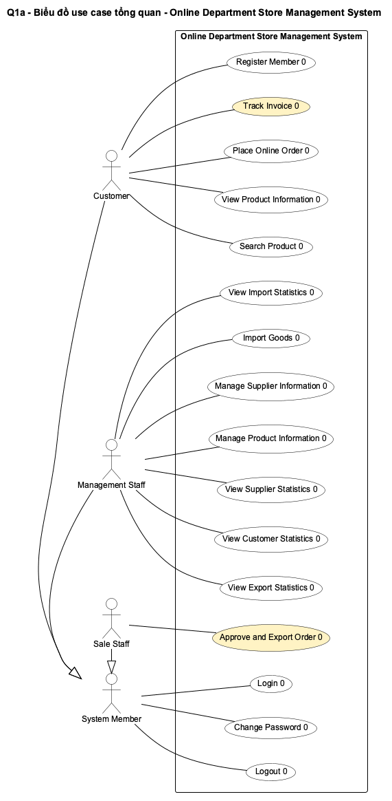

Quy tắc phân rã (giáo trình mục 3.1.3):
- **Mỗi giao diện tương tác với người dùng là một use case con.** Các nút trên cùng một giao diện và thao tác ngoài phần mềm không tách thành use case.
- Use case chính include use case đăng nhập riêng của actor (Customer Login 0, Sale Staff Login 0). Use case này kế thừa Login 0, và actor kế thừa System Member.
- Giao diện bắt buộc để hoàn thành nghiệp vụ dùng «include». Giao diện xem chi tiết **tùy chọn** từ giao diện trước dùng «extend».
- Liên kết actor – use case là đường thẳng không mũi tên.

**Module 1 – Track Invoice 0.**
- Giao diện danh sách hóa đơn là bắt buộc nên được include.
- Giao diện chi tiết chỉ mở khi khách chọn một hóa đơn nên extend danh sách.
- Trạng thái hiện tại là một trường trên giao diện chi tiết, không phải use case riêng.

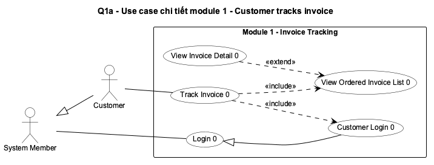

**Module 2 – Approve and Export Order 0.** Bốn giao diện đều bắt buộc để hoàn thành việc duyệt và xuất nên được include:
- danh sách đơn;
- chi tiết đơn – duyệt và xác nhận xuất là hai nút trên giao diện này;
- chọn nhân viên giao hàng;
- in hóa đơn.

Đóng gói là thao tác ngoài phần mềm, chỉ ghi trong kịch bản vì đề bài yêu cầu.

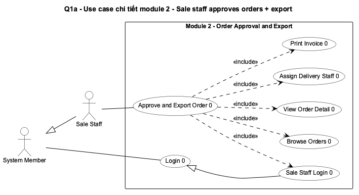

| Use case con | Giao diện | Ý nghĩa |
|---|---|---|
| Sale Staff Login 0 | Đăng nhập | Nhân viên bán hàng đăng nhập |
| Browse Orders 0 | Danh sách đơn hàng | Xem và lọc đơn chưa xuất |
| View Order Detail 0 | Chi tiết đơn hàng | Xem khách hàng, dòng hàng, tổng tiền, trạng thái; duyệt đơn và xác nhận xuất (kiểm tra và trừ tồn kho, lập hóa đơn) |
| Assign Delivery Staff 0 | Chọn nhân viên giao hàng | Chọn và lưu nhân viên giao hàng cho đơn |
| Print Invoice 0 | Xem trước và in hóa đơn | In hóa đơn giao kèm hàng |

### 1b. Kịch bản

#### Module 1 – Kịch bản chuẩn Track Invoice 0

| Trường | Nội dung |
|---|---|
| **Use case** | Track Invoice 0 (Theo dõi hóa đơn) |
| **Actor** | Customer (Khách hàng) |
| **Tiền điều kiện** | Khách hàng đã có tài khoản thành viên và đăng nhập thành công |
| **Hậu điều kiện** | Không thay đổi dữ liệu; khách hàng xem được chi tiết và trạng thái hiện tại của một hóa đơn thuộc chính mình |
| **Kịch bản chính** | 1. Khách hàng Nguyễn Văn An (KH01) chọn menu "Theo dõi hóa đơn" trên giao diện chính của khách hàng (06/09/2026 10:00).<br>2. Hệ thống hiển thị danh sách hóa đơn của các đơn khách đã đặt, mới nhất trước:<br><table><tr><th>Mã HĐ</th><th>Mã đơn</th><th>Ngày đặt</th><th>Số mặt hàng</th><th>Tổng tiền</th><th>Trạng thái</th></tr><tr><td>HD1024</td><td>DH1024</td><td>05/09/2026</td><td>3</td><td>1.250.000</td><td>Đã xuất</td></tr><tr><td>HD1011</td><td>DH1011</td><td>01/09/2026</td><td>1</td><td>175.000</td><td>Đã hủy</td></tr><tr><td>HD0987</td><td>DH0987</td><td>20/08/2026</td><td>1</td><td>540.000</td><td>Đã giao</td></tr></table><br>3. Khách hàng click dòng số 1 (mã hóa đơn = HD1024).<br>4. Hệ thống kiểm tra hóa đơn HD1024 thuộc khách hàng đang đăng nhập và hiển thị giao diện chi tiết hóa đơn: mã hóa đơn HD1024, mã đơn DH1024, ngày đặt 05/09/2026, ngày lập hóa đơn 06/09/2026, địa chỉ nhận 25 Trần Duy Hưng, Cầu Giấy, Hà Nội, danh sách sản phẩm:<br><table><tr><th>Mã SP</th><th>Tên sản phẩm</th><th>Số lượng</th><th>Đơn giá</th><th>Thành tiền</th></tr><tr><td>SP07</td><td>Gạo ST25 5kg</td><td>2</td><td>250.000</td><td>500.000</td></tr><tr><td>SP15</td><td>Dầu ăn Neptune 1L</td><td>5</td><td>60.000</td><td>300.000</td></tr><tr><td>SP22</td><td>Sữa tươi Vinamilk 1L</td><td>10</td><td>45.000</td><td>450.000</td></tr><tr><td colspan="4">Tổng tiền</td><td>1.250.000</td></tr></table>Trạng thái hiện tại: **Đã xuất** (xuất lúc 06/09/2026 09:15, nhân viên giao hàng Phạm Văn Dũng – 0912345678), kèm nút "Quay lại".<br>5. Khách hàng xem thông tin và click "Quay lại".<br>6. Hệ thống hiển thị lại danh sách hóa đơn ở bước 2. |
| **Ngoại lệ** | 2a. Khách hàng chưa có đơn nào.<br>2a.1 Hệ thống hiển thị thông báo "Bạn chưa có hóa đơn nào" và kết thúc use case.<br><br>4a. Mã hóa đơn yêu cầu không thuộc khách hàng hiện tại (ví dụ sửa `invoiceId=HD1025` trên URL).<br>4a.1 Hệ thống kiểm tra quyền sở hữu ở phía server, trả về "Không tìm thấy hóa đơn" và không hiển thị bất kỳ dữ liệu nào của hóa đơn đó (BR01).<br><br>4b. Khách hàng chọn hóa đơn của đơn đã hủy (HD1011).<br>4b.1 Hệ thống vẫn hiển thị thông tin lịch sử với trạng thái "Đã hủy" và ngày lập "Chưa lập". |

*Ghi chú:* mỗi đơn có một hóa đơn ngay từ lúc đặt (Order 1–1 Invoice) để khách theo dõi được; ngày lập hóa đơn chỉ được ghi khi nhân viên bán hàng xuất đơn (bước 18 của module 2). Trạng thái hóa đơn chính là trạng thái của đơn tương ứng. Kịch bản này diễn ra **sau** kịch bản module 2 nên HD1024 đang ở trạng thái Đã xuất.

#### Module 2 – Kịch bản chuẩn Approve and Export Order 0

| Trường | Nội dung |
|---|---|
| **Use case** | Approve and Export Order 0 (Duyệt đơn và xuất hàng) |
| **Actor** | Sale Staff (Nhân viên bán hàng) |
| **Tiền điều kiện** | Nhân viên bán hàng đã đăng nhập thành công; tồn tại ít nhất một đơn hàng chưa xuất, chưa bị hủy |
| **Hậu điều kiện** | Đơn hàng chuyển sang trạng thái "Đã xuất"; tồn kho của từng sản phẩm trong đơn giảm đúng số lượng đặt; đơn được gán nhân viên giao hàng, lưu nhân viên xử lý và thời điểm xuất; hóa đơn tương ứng được cập nhật và đã in để giao kèm hàng hóa |
| **Kịch bản chính** | 1. Nhân viên bán hàng chọn chức năng "Duyệt và xuất đơn hàng" từ giao diện chính.<br>2. Hệ thống hiển thị giao diện "Danh sách đơn hàng" có: ô chọn trạng thái, nút Lọc và vùng hiển thị danh sách đơn.<br>3. Nhân viên bán hàng chọn trạng thái "Chưa xuất" và nhấn nút "Lọc".<br>4. Hệ thống hiển thị danh sách các đơn chưa xuất:<br><table><tr><th>Mã đơn</th><th>Khách hàng</th><th>Ngày đặt</th><th>Số mặt hàng</th><th>Tổng tiền</th><th>Trạng thái</th></tr><tr><td>DH1024</td><td>Nguyễn Văn An</td><td>05/09/2026</td><td>3</td><td>1.250.000</td><td>Chờ duyệt</td></tr><tr><td>DH1025</td><td>Trần Thị Bích</td><td>05/09/2026</td><td>1</td><td>320.000</td><td>Chờ duyệt</td></tr><tr><td>DH1026</td><td>Lê Minh Cường</td><td>06/09/2026</td><td>2</td><td>780.000</td><td>Đã duyệt</td></tr></table><br>5. Nhân viên bán hàng chọn dòng số 1 (mã đơn = DH1024, khách hàng = Nguyễn Văn An).<br>6. Hệ thống hiển thị giao diện chi tiết đơn hàng DH1024 với thông tin khách hàng (Nguyễn Văn An – 0905112233 – 25 Trần Duy Hưng, Cầu Giấy, Hà Nội), trạng thái "Chờ duyệt", nút "Duyệt đơn", nút "Quay lại" và danh sách sản phẩm:<br><table><tr><th>Mã SP</th><th>Tên sản phẩm</th><th>Đơn vị</th><th>Số lượng</th><th>Đơn giá</th><th>Thành tiền</th><th>Tồn kho</th></tr><tr><td>SP07</td><td>Gạo ST25 5kg</td><td>Túi</td><td>2</td><td>250.000</td><td>500.000</td><td>40</td></tr><tr><td>SP15</td><td>Dầu ăn Neptune 1L</td><td>Chai</td><td>5</td><td>60.000</td><td>300.000</td><td>120</td></tr><tr><td>SP22</td><td>Sữa tươi Vinamilk 1L</td><td>Hộp</td><td>10</td><td>45.000</td><td>450.000</td><td>60</td></tr></table>Tổng tiền: 1.250.000<br>7. Nhân viên bán hàng kiểm tra thông tin đơn và nhấn nút "Duyệt đơn".<br>8. Hệ thống kiểm tra đơn DH1024 hợp lệ: đơn chưa bị hủy và chưa được xuất.<br>9. Hệ thống ghi nhận đơn DH1024 do nhân viên bán hàng hiện tại duyệt, chuyển trạng thái đơn thành "Đã duyệt" và hiển thị thêm nút "Chọn nhân viên giao hàng".<br>10. Nhân viên bán hàng chuẩn bị và đóng gói hàng hóa đúng theo danh sách sản phẩm và số lượng của đơn DH1024 (hoạt động thực tế ngoài phần mềm).<br>11. Nhân viên bán hàng nhấn nút "Chọn nhân viên giao hàng".<br>12. Hệ thống hiển thị danh sách nhân viên giao hàng:<br><table><tr><th>Mã NV</th><th>Họ tên</th><th>Số điện thoại</th><th>Khu vực</th><th>Số đơn đang giao</th><th>Trạng thái</th></tr><tr><td>GH03</td><td>Phạm Văn Dũng</td><td>0912345678</td><td>Cầu Giấy</td><td>1</td><td>Sẵn sàng</td></tr><tr><td>GH05</td><td>Ngô Thị Hà</td><td>0987654321</td><td>Đống Đa</td><td>0</td><td>Sẵn sàng</td></tr><tr><td>GH08</td><td>Đỗ Quang Huy</td><td>0933221100</td><td>Hà Đông</td><td>3</td><td>Đang giao</td></tr></table><br>13. Nhân viên bán hàng chọn dòng số 1 (mã = GH03, tên = Phạm Văn Dũng) và nhấn nút "Lưu phân công".<br>14. Hệ thống lưu nhân viên giao hàng GH03 cho đơn DH1024, hiển thị lại chi tiết đơn kèm nút "Xác nhận xuất hàng".<br>15. Nhân viên bán hàng nhấn nút "Xác nhận xuất hàng".<br>16. Hệ thống kiểm tra đơn DH1024 chưa từng được xuất, đã có nhân viên giao hàng và mọi sản phẩm trong đơn còn đủ số lượng trong kho.<br>17. Hệ thống trừ tồn kho từng sản phẩm: SP07 còn 38, SP15 còn 115, SP22 còn 50.<br>18. Hệ thống chuyển trạng thái đơn DH1024 thành "Đã xuất", lưu nhân viên bán hàng xử lý, thời điểm xuất 06/09/2026 09:15 và nhân viên giao hàng GH03; lập hóa đơn HD1024 (ngày lập 06/09/2026 09:15).<br>19. Hệ thống thông báo "Xuất hàng thành công cho đơn DH1024" và hiển thị nút "In hóa đơn".<br>20. Nhân viên bán hàng nhấn nút "In hóa đơn".<br>21. Hệ thống hiển thị bản xem trước hóa đơn HD1024 (khách hàng Nguyễn Văn An, ngày lập 06/09/2026, địa chỉ nhận 25 Trần Duy Hưng, Cầu Giấy, Hà Nội) kèm nút "In":<br><table><tr><th>Mã SP</th><th>Tên sản phẩm</th><th>Số lượng</th><th>Đơn giá</th><th>Thành tiền</th></tr><tr><td>SP07</td><td>Gạo ST25 5kg</td><td>2</td><td>250.000</td><td>500.000</td></tr><tr><td>SP15</td><td>Dầu ăn Neptune 1L</td><td>5</td><td>60.000</td><td>300.000</td></tr><tr><td>SP22</td><td>Sữa tươi Vinamilk 1L</td><td>10</td><td>45.000</td><td>450.000</td></tr><tr><td colspan="4">Tổng tiền hóa đơn</td><td>1.250.000</td></tr></table><br>22. Nhân viên bán hàng nhấn nút "In" và nhận bản in hóa đơn HD1024.<br>23. Nhân viên bán hàng bàn giao kiện hàng đã đóng gói cùng hóa đơn HD1024 cho nhân viên giao hàng Phạm Văn Dũng (GH03) — hoạt động thực tế ngoài phần mềm.<br>24. Hệ thống quay về danh sách đơn chưa xuất; đơn DH1024 không còn xuất hiện trong danh sách. |
| **Ngoại lệ** | 8. Đơn hàng đã bị hủy.<br>8.1 Hệ thống hiển thị thông báo "Đơn hàng DH1024 đã bị hủy, không thể duyệt".<br>8.2 Nhân viên bán hàng nhấn OK và quay về danh sách đơn chưa xuất (Bước 4).<br><br>16a. Đơn hàng đã được nhân viên bán hàng khác xuất trước đó.<br>16a.1 Hệ thống hiển thị thông báo "Đơn hàng DH1024 đã được xuất, không thể xuất lần thứ hai".<br>16a.2 Hệ thống hiển thị trạng thái mới nhất của đơn và không thay đổi tồn kho.<br>16a.3 Nhân viên bán hàng nhấn OK và quay về danh sách đơn chưa xuất (Bước 4).<br><br>16b. Một hoặc nhiều sản phẩm không đủ tồn kho.<br>16b.1 Hệ thống hiển thị thông báo "Không đủ hàng để xuất đơn DH1024" kèm danh sách sản phẩm thiếu (SP22 – Sữa tươi Vinamilk 1L: cần 10, còn 4).<br>16b.2 Hệ thống giữ nguyên tồn kho của mọi sản phẩm và giữ trạng thái đơn ở "Đã duyệt".<br>16b.3 Nhân viên bán hàng nhấn OK và quay về chi tiết đơn (Bước 14) để xử lý lại sau khi kho được bổ sung.<br><br>16c. Chưa chọn nhân viên giao hàng.<br>16c.1 Hệ thống hiển thị thông báo "Vui lòng chọn nhân viên giao hàng trước khi xuất đơn".<br>16c.2 Nhân viên bán hàng nhấn OK và thực hiện lại việc phân công (quay về Bước 11).<br><br>22. Lỗi trong quá trình in hóa đơn.<br>22.1 Hệ thống thông báo "In hóa đơn không thành công".<br>22.2 Hệ thống giữ nguyên đơn DH1024 ở trạng thái "Đã xuất" và không hoàn lại tồn kho.<br>22.3 Nhân viên bán hàng nhấn nút "In hóa đơn" để thực hiện lại (quay về Bước 20). |

- **Bước 10 và Bước 23** là hoạt động nghiệp vụ ngoài phần mềm, được giữ vì đề bài yêu cầu ("đóng gói", "giao hàng hóa và hóa đơn cho nhân viên giao hàng").
- **Số liệu nhất quán:** tồn kho ở bước 6 (40 / 120 / 60) trừ đúng số lượng đặt (2 / 5 / 10) cho kết quả bước 17 (38 / 115 / 50); tổng 1.250.000 giữ nguyên từ bước 4 tới hóa đơn HD1024; cột "Số đơn đang giao" ở bước 12 khớp số đơn Đã xuất/Đang giao của từng người trong CSDL mẫu.
- **Quy tắc nghiệp vụ:** BR02 chỉ Sale Staff duyệt/xuất; BR03 mỗi đơn xuất một lần (16a); BR04 đủ tồn kho mới xuất (16b); BR05 trừ kho + đổi trạng thái + lập hóa đơn trong cùng một transaction; BR06 phải phân công giao hàng trước khi xuất (16c); BR07 trạng thái đi Chờ duyệt → Đã duyệt → Đã xuất.

---

## Question 2

### 2a. Trích lớp thực thể

**Mô tả chức năng bằng văn xuôi (gộp hai module).** Khách hàng đăng nhập, chọn theo dõi hóa đơn; hệ thống hiển thị các hóa đơn của những đơn khách đã đặt, mỗi hóa đơn có mã, ngày lập, tổng tiền và trạng thái của đơn. Khách chọn một hóa đơn để xem các dòng hàng (sản phẩm, số lượng, đơn giá, thành tiền), địa chỉ nhận và nhân viên giao hàng. Nhân viên bán hàng xem danh sách đơn chưa xuất, mỗi đơn có mã, khách hàng, ngày đặt, địa chỉ nhận, tổng tiền và trạng thái; chọn một đơn để xem các dòng chi tiết kèm tồn kho của sản phẩm; duyệt đơn (lưu nhân viên và thời điểm duyệt); đóng gói; chọn một nhân viên giao hàng (họ tên, điện thoại, khu vực, trạng thái); xác nhận xuất – hệ thống kiểm tra và trừ tồn kho, ghi thời điểm xuất và lập hóa đơn; cuối cùng in hóa đơn giao cùng hàng.

**Trích và đánh giá danh từ.**

| Danh từ | Đánh giá | Kết luận |
|---|---|---|
| Hệ thống, menu, giao diện, nút, danh sách, thông báo | Quá chung hoặc thuộc tầng giao diện (Boundary) | Loại |
| Đóng gói, bàn giao hàng | Hoạt động thủ công, không sinh dữ liệu lưu trữ | Loại |
| Trạng thái (của đơn / hóa đơn) | Giá trị mô tả đơn | Thuộc tính `status` của **Order** |
| Thành viên (tài khoản) | Khách hàng và nhân viên đều đăng nhập, dùng chung thông tin cá nhân | **Member**: username, password, fullName, email, phone, address |
| Khách hàng | Người đặt đơn, chủ sở hữu hóa đơn | **Customer** kế thừa Member: code (mã KH) |
| Nhân viên, nhân viên bán hàng | Người duyệt và xuất đơn, cần lưu để truy vết | **Staff** kế thừa Member: code, position; **SaleStaff** kế thừa Staff |
| Nhân viên giao hàng | Được phân công cho đơn, khách xem được người giao | **DeliveryStaff**: code, fullName, phone, area, status |
| Đơn hàng | Đối tượng trung tâm của cả hai module | **Order**: code, orderDate, shippingAddress, totalAmount, status, approvedAt, exportedAt |
| Dòng chi tiết đơn | Gắn một sản phẩm với số lượng và giá tại thời điểm đặt | **OrderDetail**: quantity, unitPrice, lineAmount |
| Sản phẩm, tồn kho | Hàng hóa bị trừ kho khi xuất | **Product**: code, productName, unit, salePrice, stockQuantity, status |
| Hóa đơn, ngày lập | Chứng từ khách theo dõi và nhân viên in | **Invoice**: code, issueDate, totalAmount |

**Kết quả: 7 lớp thực thể** – Customer, SaleStaff, DeliveryStaff, Order, OrderDetail, Product, Invoice – cùng hai lớp cha **Member** và **Staff** (đúng cây kế thừa ở mục mô tả hệ thống của báo cáo). Theo giáo trình, pha phân tích **chưa có thuộc tính id**; `code` là mã nghiệp vụ hiển thị cho người dùng (KH01, NV01, GH03, SP07, DH1024, HD1024), tương tự `masv` trong giáo trình. Thuộc tính `id` được bổ sung ở pha thiết kế (Q4a). Module 1 dùng Customer, Order, OrderDetail, Product, Invoice, DeliveryStaff; module 2 dùng cả bảy.

**Quan hệ.**

- Customer 1 – 0..* Order: một khách đặt nhiều đơn, mỗi đơn thuộc đúng một khách.
- SaleStaff 0..1 – 0..* Order: đơn chưa duyệt chưa có nhân viên; sau khi duyệt/xuất gắn đúng một nhân viên xử lý.
- DeliveryStaff 0..1 – 0..* Order: đơn chỉ có nhân viên giao hàng sau khi được phân công.
- Order – Product là n–n nên tách bằng **OrderDetail**: Order 1 ◆— 1..* OrderDetail (**composition**: dòng chi tiết không tồn tại khi không có đơn); OrderDetail 0..* ◇— 1 Product (**aggregation**: sản phẩm tồn tại độc lập; `unitPrice` được sao chép lúc đặt nên không đổi khi giá sản phẩm thay đổi – BR08).
- Order 1 – 1 Invoice: mỗi đơn có đúng một hóa đơn; giữ hai lớp riêng vì hóa đơn có mã và ngày lập riêng. Hóa đơn **không** có thuộc tính trạng thái riêng – trạng thái hóa đơn chính là `Order.status`, tránh hai giá trị lệch nhau.

### 2b. Biểu đồ lớp thực thể

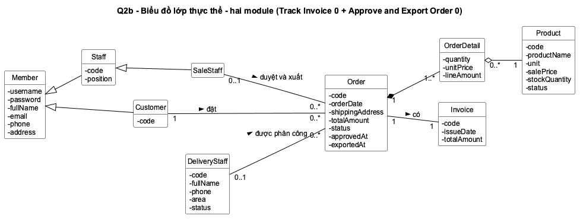

---

## Question 3

Thiết kế theo mẫu **MVC trên J2EE** và các bước trong phụ lục "Từ phân tích đến thiết kế" của môn học: (1) thêm phương thức, (2) thay association bằng `<<use>>`, (3) dùng DAO (interface + lớp Impl), (4) chia gói view / controller / dao / model.

- **View** – trang JSP, giữ tên và các thành phần giao diện (`in…`, `out…`, `sub…`) của lớp Boundary ở pha phân tích.
- **Controller** – Servlet nhận request, gọi DAO, `forward` tới JSP. Mỗi luồng một controller: `InvoiceTrackingController` (module 1), `OrderExportController` và `InvoicePrintController` (module 2).
- **DAO** – interface trong gói `dao`, cài đặt JDBC trong `dao.impl`. Các phương thức phân tích được chuyển thành phương thức DAO: `listUnexported()` → `getUnexportedOrders()`, `listByOrder()` → `getByOrder()`, `approve()` → `approveOrder()`, `assignDelivery()` → `assignDeliveryStaff()`, `checkStock()`/`decreaseStock()` → `ProductDAO`, `export()` → `exportOrder()`, `issue()` → `issueInvoice()`, `getInvoiceDetail()` → `getInvoiceByOrder()` / `getInvoiceOfCustomer()`.
- **Model** – JavaBean thuần: thuộc tính private + getter/setter; association trở thành thuộc tính tham chiếu (`Order.customer`, `Order.details`, `Invoice.order`…).

### 3a. Biểu đồ giao tiếp cho kịch bản chuẩn

Theo giáo trình (mục 3.2.3–3.2.4), biểu đồ giao tiếp thuộc **pha phân tích**, làm theo ba bước:
1. Vẽ biểu đồ lớp phân tích (Boundary – Entity) của modul.
2. Viết kịch bản phiên bản 2 từ biểu đồ lớp đó; mỗi bước là hành động của một lớp hoặc của tác nhân.
3. Vẽ biểu đồ giao tiếp đánh số đúng theo kịch bản v2, chỉ dùng các lớp và quan hệ có trong biểu đồ lớp phân tích.

Thông điệp dùng mẫu `gọi` → phương thức của entity (tự gọi) → `trả về` → `hiển thị`.

#### Bước 1 – Biểu đồ lớp phân tích

Quy ước:
- Mỗi giao diện là một lớp biên. Thành phần giao diện có tiền tố `in` (nhập), `out` (hiển thị), `sub` (submit), `outsub` (bảng click được); mỗi giao diện con có nút `subBack` để quay lại.
- Phương thức được gán cho lớp thực thể theo **tham số đầu ra**.
- Quan hệ giữa các lớp thực thể giữ nguyên như biểu đồ thực thể ở Q2b.

**Module 1 – Track Invoice 0**

| Lớp biên | Thành phần |
|---|---|
| `CustomerHomeView` | `-subTrackInvoice` |
| `InvoiceListView` | `-outsubInvoiceList`, `-subBack` |
| `InvoiceDetailView` | `-outInvoiceInfo`, `-outsubItemList`, `-outTotalAmount`, `-outStatus`, `-subBack` |

| Phương thức | Lớp | Lý do |
|---|---|---|
| `getInvoiceByCustomer()` | `Invoice` | Đầu ra là danh sách `Invoice` của khách hàng đang đăng nhập |
| `getInvoiceDetail()` | `Invoice` | Đầu ra là một `Invoice` kèm các dòng hàng và trạng thái của đơn; dùng lại ở module 2 để in hóa đơn |

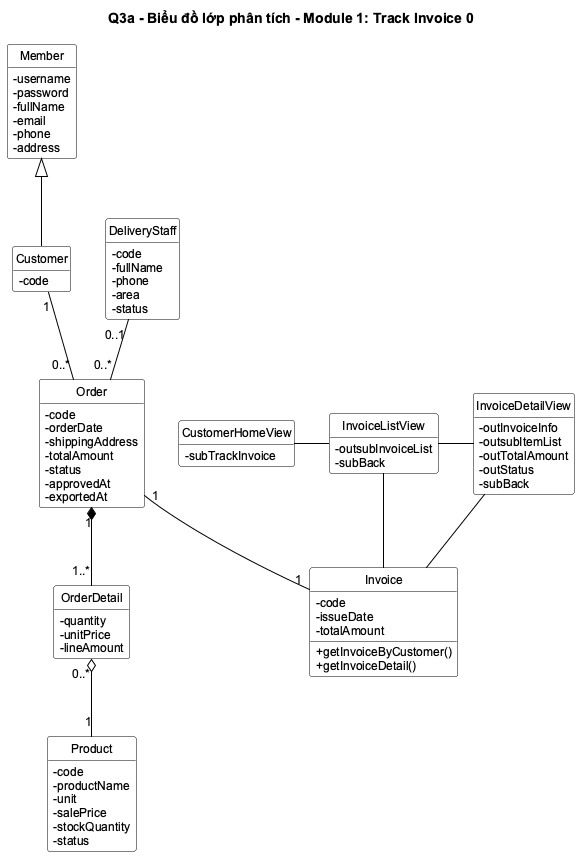

**Module 2 – Approve and Export Order 0.** Lớp biên và cách gán 10 phương thức như ở báo cáo gốc ([source/uc-sale-approve-export.md §4](source/uc-sale-approve-export.md)), bổ sung `subBack` cho các giao diện con và quan hệ giữa các lớp thực thể.

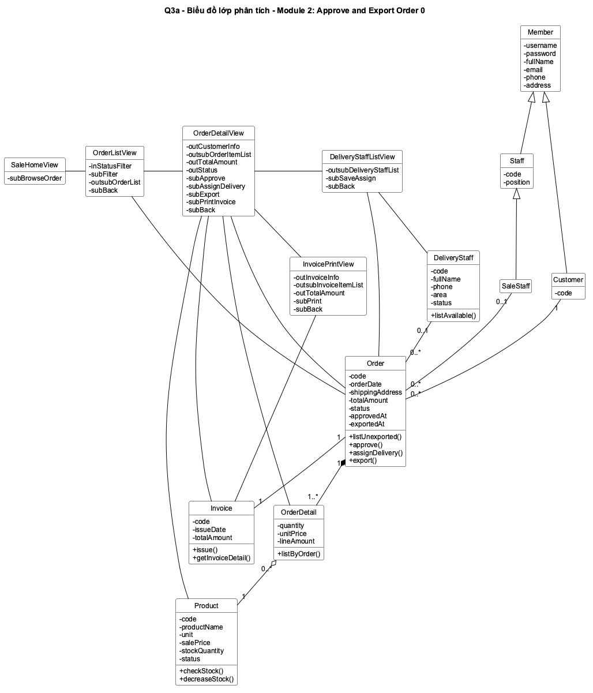

#### Bước 2 – Kịch bản phiên bản 2

**Module 1 – Track Invoice 0 (15 bước)**

1. Khách hàng click nút `subTrackInvoice` trên giao diện `CustomerHomeView`.
2. Lớp `CustomerHomeView` gọi lớp `InvoiceListView`.
3. Lớp `InvoiceListView` gọi lớp `Invoice` yêu cầu tìm các hóa đơn của khách hàng.
4. Lớp `Invoice` gọi phương thức `getInvoiceByCustomer()`.
5. Lớp `Invoice` trả danh sách hóa đơn (HD1024, HD1011, HD0987) về cho `InvoiceListView`.
6. Lớp `InvoiceListView` hiển thị danh sách hóa đơn cho khách hàng.
7. Khách hàng click hóa đơn HD1024 trong `outsubInvoiceList`.
8. Lớp `InvoiceListView` gọi lớp `InvoiceDetailView`.
9. Lớp `InvoiceDetailView` gọi lớp `Invoice` yêu cầu lấy chi tiết hóa đơn HD1024.
10. Lớp `Invoice` gọi phương thức `getInvoiceDetail()`.
11. Lớp `Invoice` trả thông tin hóa đơn, các dòng hàng và trạng thái hiện tại của đơn về cho `InvoiceDetailView`.
12. Lớp `InvoiceDetailView` hiển thị chi tiết hóa đơn và trạng thái "Đã xuất" cho khách hàng.
13. Khách hàng click nút `subBack`.
14. Lớp `InvoiceDetailView` gọi lại lớp `InvoiceListView`.
15. Lớp `InvoiceListView` hiển thị lại danh sách hóa đơn cho khách hàng.

*Ngoại lệ:*
- Bước 5: danh sách rỗng → `InvoiceListView` hiển thị "Bạn chưa có hóa đơn nào".
- Bước 11: hóa đơn không thuộc khách hàng → `Invoice` không trả dữ liệu; `InvoiceDetailView` hiển thị "Không tìm thấy hóa đơn".

**Module 2 – Approve and Export Order 0 (51 bước):** giữ nguyên kịch bản v2 của báo cáo gốc ([source/uc-sale-approve-export.md §6.1](source/uc-sale-approve-export.md)) và 5 block ngoại lệ ở §6.3.

#### Bước 3 – Biểu đồ giao tiếp

Biểu đồ được sinh trực tiếp từ kịch bản v2 nên số bước khớp 1:1 với biểu đồ tuần tự ở phụ lục. Liên kết không có chiều; mũi tên nhỏ ► cạnh nhãn chỉ chiều thông điệp. Thông điệp theo hai chiều giữa cùng hai đối tượng được đặt trên hai đường song song, vì PlantUML chỉ gắn được một mũi tên cho mỗi nhãn.

**Module 1 – Track Invoice 0** (15 thông điệp)

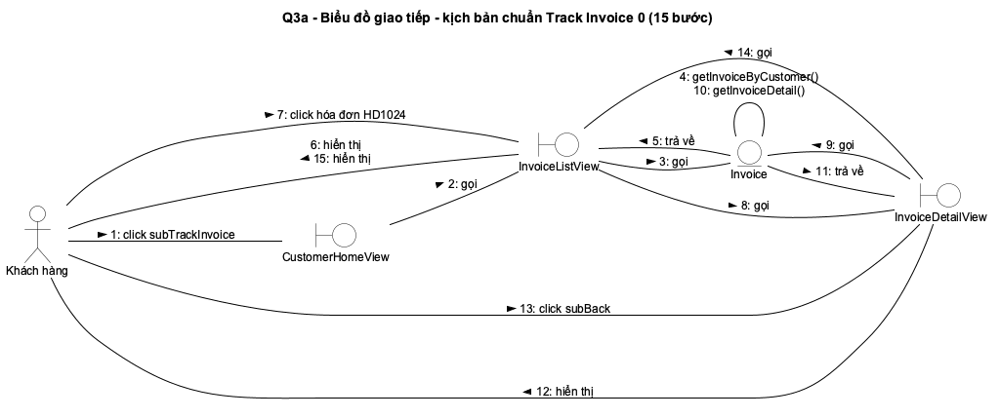

**Module 2 – Approve and Export Order 0** (51 thông điệp): 1–7 lọc đơn chưa xuất, 8–13 xem chi tiết DH1024, 14–18 duyệt, 19–29 phân công GH03, 30–43 xuất đơn, 44–51 in hóa đơn.

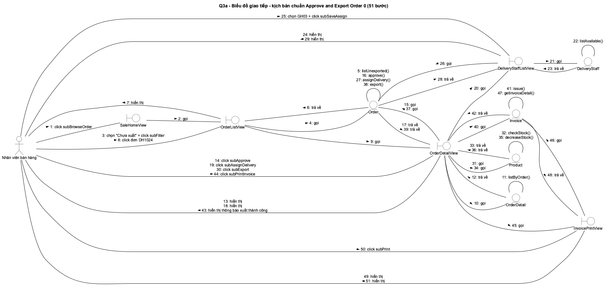

### 3b. Thiết kế chi tiết cho hai module

Theo giáo trình mục 4.3, thiết kế trên nền **J2EE dùng JSP + DAO**:
- **Tầng giao diện** gồm trang `gd*.jsp` (hiển thị) và `do*.jsp` (xử lí khi submit). Mỗi trang giữ các thành phần giao diện của lớp biên pha phân tích, cộng các **thuộc tính ẩn** chứa đối tượng truyền giữa các trang (lưu trong session).
- **Tầng truy cập dữ liệu**: lớp cơ sở `DAO` giữ một kết nối tĩnh dùng chung; mỗi lớp thực thể cần phương thức ở pha phân tích có một lớp `XxxDAO extends DAO`. Các phương thức phân tích chuyển thành phương thức DAO: `getInvoiceByCustomer()`, `getInvoiceDetail()` → `InvoiceDAO`; `listUnexported()` → `OrderDAO.getUnexportedOrder()`; `approve()`, `assignDelivery()`, `export()` → `OrderDAO.approveOrder()`, `assignDeliveryStaff()`, `exportOrder()`; `listByOrder()` → `OrderDetailDAO.getOrderDetailByOrder()`; `checkStock()`, `decreaseStock()` → `ProductDAO`; `listAvailable()` → `DeliveryStaffDAO.getAvailableDeliveryStaff()`; `issue()` → `InvoiceDAO.issueInvoice()`.
- **Tầng thực thể**: các lớp của biểu đồ thực thể pha thiết kế (Q4a), giữ nguyên quan hệ.

#### Thiết kế giao diện

Mỗi giao diện ứng với một lớp biên pha phân tích. Các cột khớp đúng bảng dữ liệu của kịch bản chuẩn (Q1b), và mọi màn hình con có nút Quay lại.

**Module 1 – Track Invoice 0**

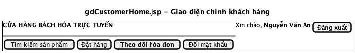

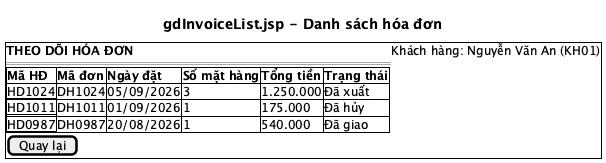

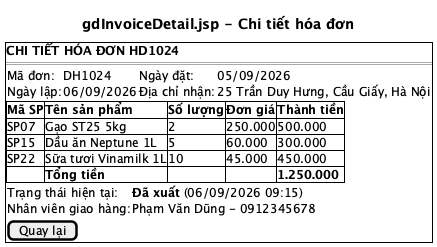

**Module 2 – Approve and Export Order 0**

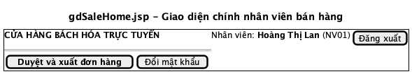

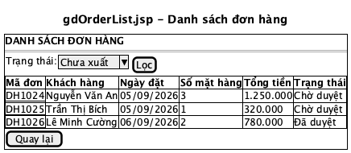

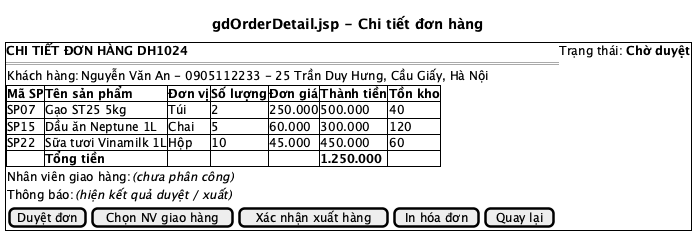

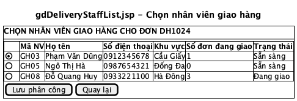

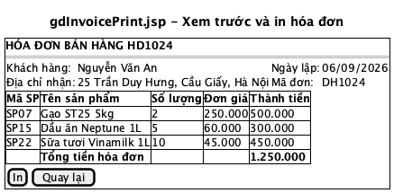

#### Sơ đồ lớp module

**Module 1 – Track Invoice 0.** Trang `gdInvoiceList.jsp` và `gdInvoiceDetail.jsp` dùng `InvoiceDAO`. `getInvoiceDetail(idInvoice, idCustomer)` chỉ trả về hóa đơn thuộc khách hàng đang đăng nhập (BR01).

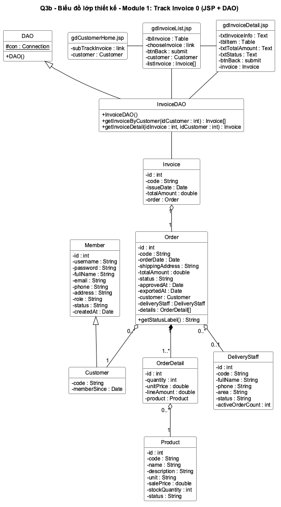

**Module 2 – Approve and Export Order 0.**
- Ba trang `do*.jsp` set thuộc tính cho đối tượng `Order` rồi gọi `OrderDAO` lưu.
- `OrderDAO.exportOrder()` dùng `ProductDAO` và `InvoiceDAO` trên cùng kết nối tĩnh của `DAO`. Nhờ vậy trừ tồn kho, đổi trạng thái và lập hóa đơn nằm trong **một giao dịch** (BR05).

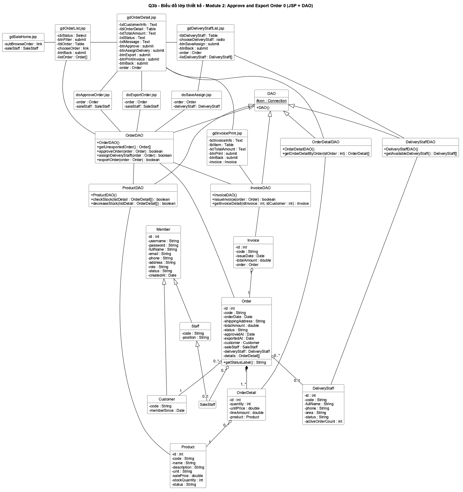

#### Biểu đồ hoạt động

Mỗi vùng là phần xử lí tại một trang JSP; mỗi hoạt động ứng với một phương thức đã thiết kế, và lời gọi DAO vẽ bằng nút đối tượng (giáo trình mục 4.3.2, bước 1).

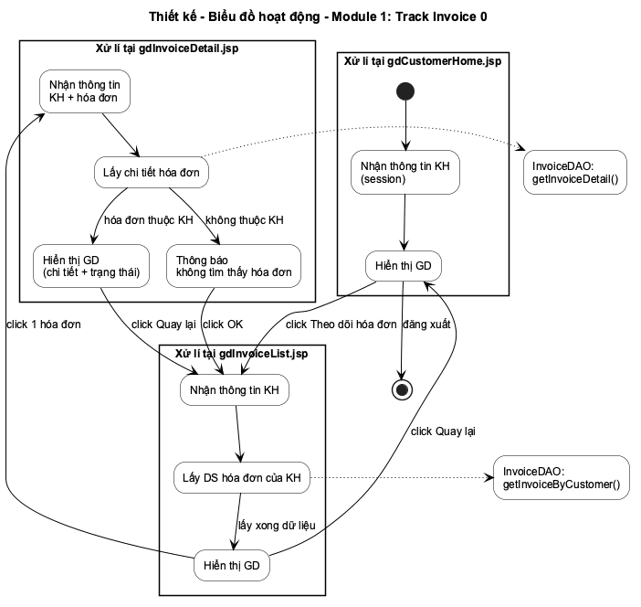

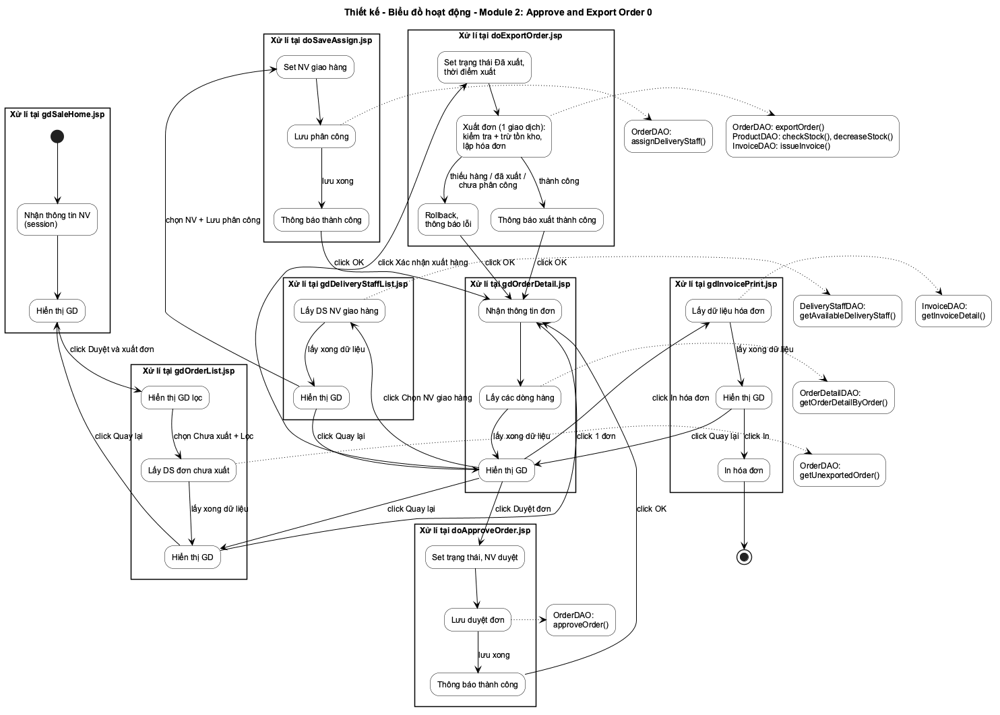

#### Kịch bản phiên bản 3

Tên hành động là tên phương thức đã thiết kế. Theo giáo trình, các bước đóng gói thuộc tính con của lớp thực thể (Order, OrderDetail, Product… bên trong Invoice) được lược bỏ cho gọn.

**Module 1 – Track Invoice 0 (21 bước)**

1. Tại trang gdCustomerHome.jsp, sau khi đăng nhập, khách hàng click chọn chức năng theo dõi hóa đơn.
2. Trang gdCustomerHome.jsp gọi trang gdInvoiceList.jsp.
3. Trang gdInvoiceList.jsp gọi lớp InvoiceDAO yêu cầu lấy danh sách hóa đơn của khách hàng.
4. Lớp InvoiceDAO gọi hàm getInvoiceByCustomer(idCustomer).
5. Hàm getInvoiceByCustomer() gọi lớp Invoice để đóng gói thông tin.
6. Lớp Invoice đóng gói thông tin thực thể.
7. Lớp Invoice trả kết quả cho hàm getInvoiceByCustomer().
8. Hàm getInvoiceByCustomer() trả kết quả cho trang gdInvoiceList.jsp.
9. Trang gdInvoiceList.jsp hiển thị danh sách hóa đơn cho khách hàng.
10. Khách hàng click hóa đơn HD1024.
11. Trang gdInvoiceList.jsp gọi trang gdInvoiceDetail.jsp.
12. Trang gdInvoiceDetail.jsp gọi lớp InvoiceDAO yêu cầu lấy chi tiết hóa đơn HD1024 của khách hàng.
13. Lớp InvoiceDAO gọi hàm getInvoiceDetail(idInvoice, idCustomer).
14. Hàm getInvoiceDetail() gọi lớp Invoice để đóng gói thông tin.
15. Lớp Invoice đóng gói thông tin thực thể.
16. Lớp Invoice trả kết quả cho hàm getInvoiceDetail().
17. Hàm getInvoiceDetail() trả kết quả cho trang gdInvoiceDetail.jsp.
18. Trang gdInvoiceDetail.jsp hiển thị chi tiết hóa đơn và trạng thái hiện tại cho khách hàng.
19. Khách hàng click nút Quay lại.
20. Trang gdInvoiceDetail.jsp gọi lại trang gdInvoiceList.jsp.
21. Trang gdInvoiceList.jsp hiển thị lại danh sách hóa đơn.

**Module 2 – Approve and Export Order 0 (86 bước)**

1. Tại trang gdSaleHome.jsp, sau khi đăng nhập, nhân viên bán hàng chọn chức năng duyệt và xuất đơn hàng.
2. Trang gdSaleHome.jsp gọi trang gdOrderList.jsp.
3. Trang gdOrderList.jsp hiển thị ô chọn trạng thái và nút Lọc.
4. Nhân viên bán hàng chọn trạng thái "Chưa xuất" và click Lọc.
5. Trang gdOrderList.jsp submit gọi chính nó xử lí.
6. Trang gdOrderList.jsp gọi lớp OrderDAO yêu cầu lấy danh sách đơn chưa xuất.
7. Lớp OrderDAO gọi hàm getUnexportedOrder().
8. Hàm getUnexportedOrder() gọi lớp Order để đóng gói thông tin.
9. Lớp Order đóng gói thông tin thực thể.
10. Lớp Order trả kết quả cho hàm getUnexportedOrder().
11. Hàm getUnexportedOrder() trả kết quả cho trang gdOrderList.jsp.
12. Trang gdOrderList.jsp hiển thị danh sách đơn chưa xuất (DH1024, DH1025, DH1026).
13. Nhân viên bán hàng click đơn DH1024.
14. Trang gdOrderList.jsp gọi trang gdOrderDetail.jsp.
15. Trang gdOrderDetail.jsp gọi lớp OrderDetailDAO yêu cầu lấy các dòng hàng của đơn DH1024.
16. Lớp OrderDetailDAO gọi hàm getOrderDetailByOrder(idOrder).
17. Hàm getOrderDetailByOrder() gọi lớp OrderDetail để đóng gói thông tin.
18. Lớp OrderDetail đóng gói thông tin thực thể.
19. Lớp OrderDetail trả kết quả cho hàm getOrderDetailByOrder().
20. Hàm getOrderDetailByOrder() trả kết quả cho trang gdOrderDetail.jsp.
21. Trang gdOrderDetail.jsp hiển thị chi tiết đơn DH1024 (trạng thái Chờ duyệt).
22. Nhân viên bán hàng kiểm tra đơn và click Duyệt đơn.
23. Trang gdOrderDetail.jsp gọi trang doApproveOrder.jsp.
24. Trang doApproveOrder.jsp gọi lớp Order yêu cầu set trạng thái Đã duyệt, nhân viên duyệt và thời điểm duyệt.
25. Lớp Order gọi các hàm setStatus(), setSaleStaff(), setApprovedAt().
26. Lớp Order trả đối tượng về cho trang doApproveOrder.jsp.
27. Trang doApproveOrder.jsp gọi lớp OrderDAO yêu cầu lưu.
28. Lớp OrderDAO gọi hàm approveOrder(order).
29. Lớp OrderDAO trả kết quả cho trang doApproveOrder.jsp.
30. Trang doApproveOrder.jsp thông báo "Duyệt đơn thành công".
31. Nhân viên bán hàng click OK của thông báo.
32. Trang doApproveOrder.jsp gọi lại trang gdOrderDetail.jsp.
33. Trang gdOrderDetail.jsp hiển thị đơn DH1024 ở trạng thái Đã duyệt.
34. Nhân viên bán hàng đóng gói hàng rồi click Chọn nhân viên giao hàng.
35. Trang gdOrderDetail.jsp gọi trang gdDeliveryStaffList.jsp.
36. Trang gdDeliveryStaffList.jsp gọi lớp DeliveryStaffDAO yêu cầu lấy danh sách nhân viên giao hàng.
37. Lớp DeliveryStaffDAO gọi hàm getAvailableDeliveryStaff().
38. Hàm getAvailableDeliveryStaff() gọi lớp DeliveryStaff để đóng gói thông tin.
39. Lớp DeliveryStaff đóng gói thông tin thực thể.
40. Lớp DeliveryStaff trả kết quả cho hàm getAvailableDeliveryStaff().
41. Hàm getAvailableDeliveryStaff() trả kết quả cho trang gdDeliveryStaffList.jsp.
42. Trang gdDeliveryStaffList.jsp hiển thị danh sách nhân viên giao hàng.
43. Nhân viên bán hàng chọn GH03 – Phạm Văn Dũng và click Lưu phân công.
44. Trang gdDeliveryStaffList.jsp gọi trang doSaveAssign.jsp.
45. Trang doSaveAssign.jsp gọi lớp Order yêu cầu set nhân viên giao hàng GH03.
46. Lớp Order gọi các hàm setDeliveryStaff().
47. Lớp Order trả đối tượng về cho trang doSaveAssign.jsp.
48. Trang doSaveAssign.jsp gọi lớp OrderDAO yêu cầu lưu.
49. Lớp OrderDAO gọi hàm assignDeliveryStaff(order).
50. Lớp OrderDAO trả kết quả cho trang doSaveAssign.jsp.
51. Trang doSaveAssign.jsp thông báo "Phân công thành công".
52. Nhân viên bán hàng click OK của thông báo.
53. Trang doSaveAssign.jsp gọi lại trang gdOrderDetail.jsp.
54. Trang gdOrderDetail.jsp hiển thị đơn kèm nhân viên giao hàng và nút Xác nhận xuất hàng.
55. Nhân viên bán hàng click Xác nhận xuất hàng.
56. Trang gdOrderDetail.jsp gọi trang doExportOrder.jsp.
57. Trang doExportOrder.jsp gọi lớp Order yêu cầu set trạng thái Đã xuất, nhân viên xử lí và thời điểm xuất.
58. Lớp Order gọi các hàm setStatus(), setSaleStaff(), setExportedAt().
59. Lớp Order trả đối tượng về cho trang doExportOrder.jsp.
60. Trang doExportOrder.jsp gọi lớp OrderDAO yêu cầu lưu xuất đơn.
61. Lớp OrderDAO gọi hàm exportOrder(), mở giao dịch (setAutoCommit(false)) trên kết nối dùng chung.
62. Hàm exportOrder() gọi lớp ProductDAO yêu cầu kiểm tra tồn kho.
63. Lớp ProductDAO gọi hàm checkStock().
64. Hàm checkStock() trả kết quả đủ tồn kho cho hàm exportOrder().
65. Hàm exportOrder() gọi lớp ProductDAO yêu cầu trừ tồn kho.
66. Lớp ProductDAO gọi hàm decreaseStock().
67. Hàm decreaseStock() trả kết quả cho hàm exportOrder().
68. Hàm exportOrder() gọi lớp InvoiceDAO yêu cầu lập hóa đơn.
69. Lớp InvoiceDAO gọi hàm issueInvoice().
70. Hàm issueInvoice() trả kết quả cho hàm exportOrder(); exportOrder() commit giao dịch.
71. Lớp OrderDAO trả kết quả cho trang doExportOrder.jsp.
72. Trang doExportOrder.jsp thông báo "Xuất hàng thành công cho đơn DH1024".
73. Nhân viên bán hàng click OK của thông báo.
74. Trang doExportOrder.jsp gọi lại trang gdOrderDetail.jsp.
75. Trang gdOrderDetail.jsp hiển thị đơn ở trạng thái Đã xuất kèm nút In hóa đơn.
76. Nhân viên bán hàng click In hóa đơn.
77. Trang gdOrderDetail.jsp gọi trang gdInvoicePrint.jsp.
78. Trang gdInvoicePrint.jsp gọi lớp InvoiceDAO yêu cầu lấy dữ liệu hóa đơn HD1024.
79. Lớp InvoiceDAO gọi hàm getInvoiceDetail(idInvoice, idCustomer).
80. Hàm getInvoiceDetail() gọi lớp Invoice để đóng gói thông tin.
81. Lớp Invoice đóng gói thông tin thực thể.
82. Lớp Invoice trả kết quả cho hàm getInvoiceDetail().
83. Hàm getInvoiceDetail() trả kết quả cho trang gdInvoicePrint.jsp.
84. Trang gdInvoicePrint.jsp hiển thị bản xem trước hóa đơn HD1024.
85. Nhân viên bán hàng click In.
86. Trang gdInvoicePrint.jsp gửi lệnh in; nhân viên bán hàng nhận bản in để giao cùng hàng.

*Ngoại lệ:* `exportOrder()` rollback toàn bộ giao dịch và `doExportOrder.jsp` thông báo lỗi khi:
- `checkStock()` báo thiếu hàng (16b);
- đơn đã được xuất trước đó (16a);
- đơn chưa được phân công nhân viên giao hàng (16c).

`doApproveOrder.jsp` thông báo lỗi khi đơn đã bị hủy (8).

#### Biểu đồ tuần tự thiết kế

Sinh trực tiếp từ kịch bản v3 nên số bước khớp 1:1.

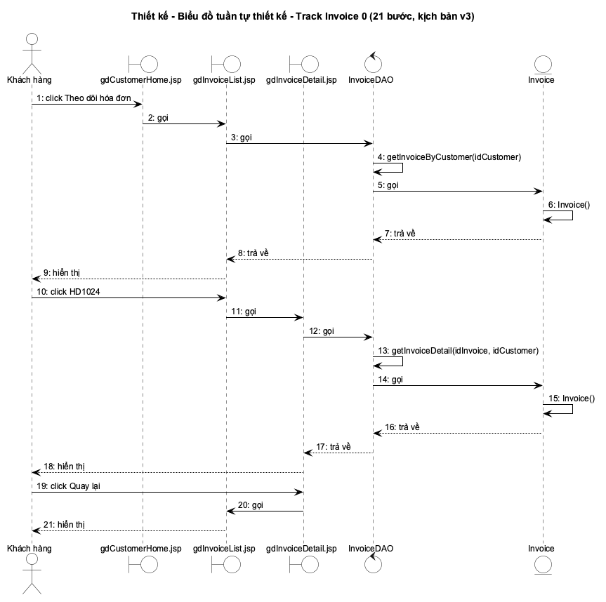

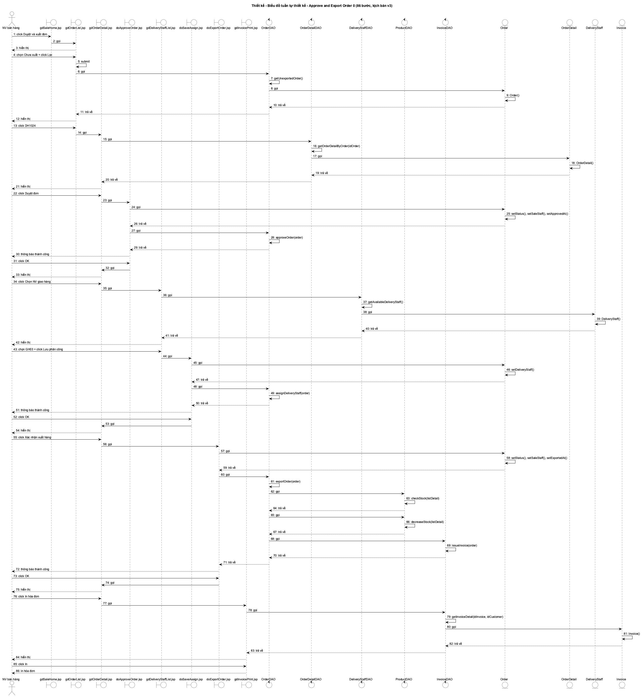

---

## Question 4

### 4a. Thiết kế lớp thực thể và CSDL của hệ thống

#### Biểu đồ lớp thực thể pha thiết kế của HỆ THỐNG

Đầu vào là các đối tượng của toàn hệ thống (mục 2, Bước 4–5 của báo cáo). Làm theo 4 bước của giáo trình (mục 4.1):
1. Bổ sung `id : int` cho mọi lớp không kế thừa lớp khác. Các lớp con Customer, Staff, SaleStaff, ManagementStaff và các lớp thống kê không có `id`.
2. Bổ sung kiểu dữ liệu Java.
3. Chuyển association thành aggregation hoặc composition:
   - Order ◆ OrderDetail và ImportReceipt ◆ ImportReceiptDetail là composition;
   - các quan hệ tham chiếu còn lại là aggregation.
4. Lớp chứa khai báo thuộc tính đối tượng, dùng `[]` cho quan hệ nhiều (`details : OrderDetail[]`).

Các lớp thống kê (CustomerStat, SupplierStat, ImportStat, ExportStat) kế thừa lớp thực thể tương ứng.

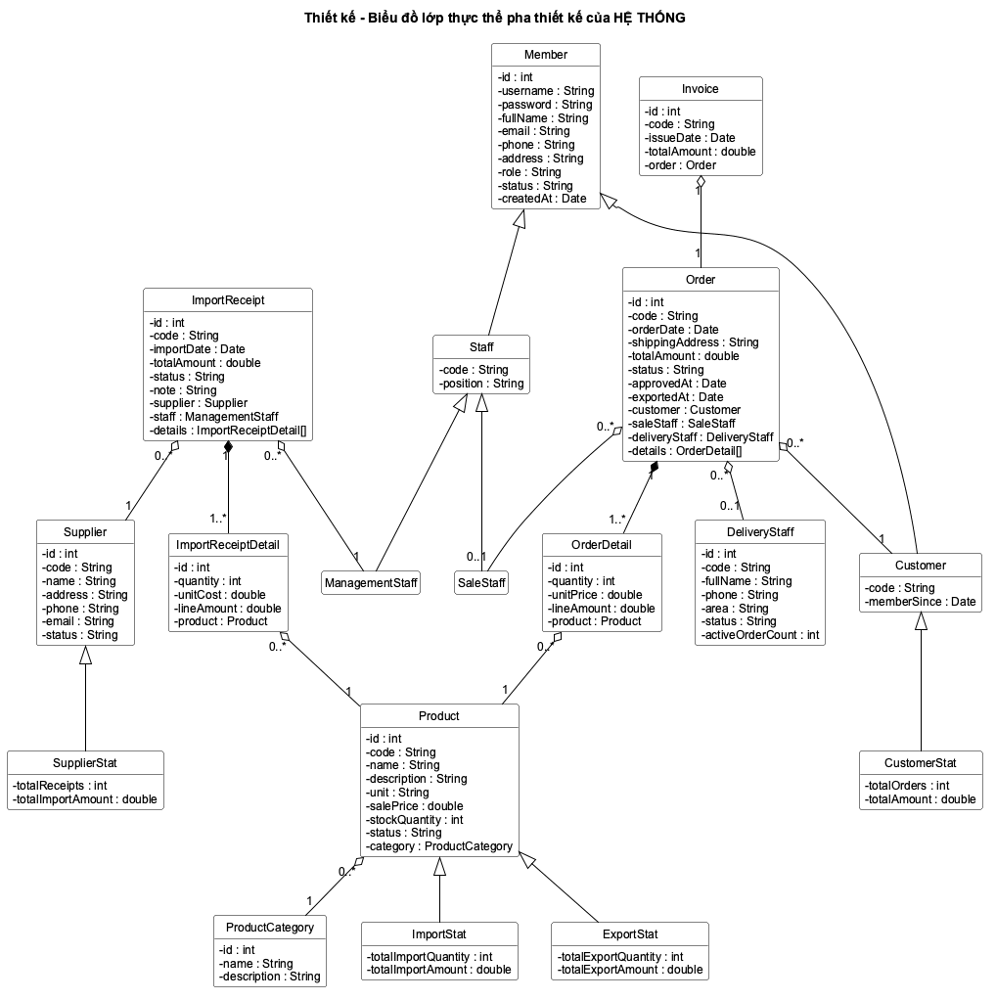

#### Biểu đồ CSDL của HỆ THỐNG

Script: [sql/system_schema.sql](sql/system_schema.sql). Biểu đồ được sinh từ chính script này, và script đã chạy kiểm tra trên SQLite với khóa ngoại được bật.

| Bước | Áp dụng |
|---|---|
| 1–2 | Mỗi lớp thực thể → bảng `tbl…`; chỉ lấy thuộc tính kiểu cơ bản, chuyển sang kiểu SQL |
| 3 | Quan hệ 1–n giữ nguyên. **Order 1–1 Invoice → gộp** hóa đơn vào `tblOrder` (`invoiceCode`, `issueDate`) |
| 4 | Khóa chính `id`. Bảng lớp con `tblCustomer`, `tblStaff` dùng `tblMemberid` vừa là khóa chính vừa là khóa ngoại. Khóa ngoại đặt tên `tbl<Bảng>id` |
| 5 | Loại thuộc tính dẫn xuất: `totalAmount`, `lineAmount` (tính từ số lượng × đơn giá). Loại bảng `tblSaleStaff`, `tblManagementStaff` (chỉ còn một khóa ngoại; phân biệt bằng `tblMember.role`) và các bảng thống kê. **Giữ** `tblOrderDetail.unitPrice` vì là giá lúc đặt (BR08) |

Kết quả có 11 bảng; mọi khóa ngoại đều có chỉ mục.

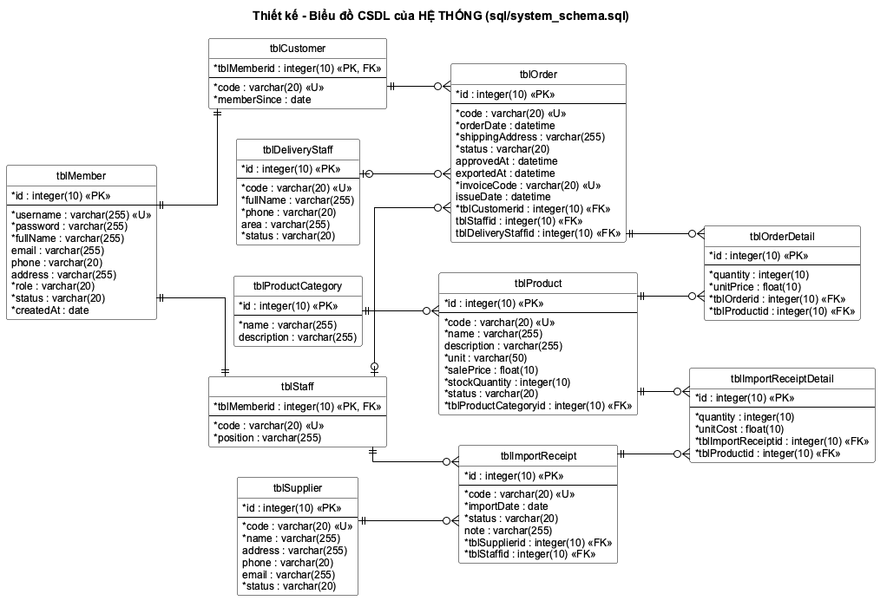

#### CSDL liên quan đến hai module

Đề yêu cầu thiết kế CSDL **dựa trên các lớp thực thể của Q2**. Ánh xạ từng lớp sang bảng:

| Lớp thực thể (Q2) | Bảng | Ghi chú |
|---|---|---|
| Member | `tblMember` | Lớp cha: tài khoản, họ tên, điện thoại, địa chỉ, `role` |
| Customer | `tblCustomer` | `tblMemberid` vừa là khóa chính vừa là khóa ngoại tới `tblMember` |
| Staff, SaleStaff | `tblStaff` | SaleStaff không có thuộc tính riêng nên không có bảng riêng (bước 5); phân biệt bằng `tblMember.role` |
| DeliveryStaff | `tblDeliveryStaff` | `activeOrderCount` là thuộc tính dẫn xuất, không lưu |
| Product | `tblProduct` | Kèm khóa ngoại tới `tblProductCategory` của hệ thống |
| Order | `tblOrder` | `totalAmount` dẫn xuất, không lưu; khóa ngoại tới khách hàng, nhân viên bán hàng, nhân viên giao hàng |
| OrderDetail | `tblOrderDetail` | `lineAmount` dẫn xuất, không lưu; giữ `unitPrice` (giá lúc đặt, BR08) |
| Invoice | gộp vào `tblOrder` | Quan hệ 1–1 nên gộp (bước 3): `invoiceCode`, `issueDate` |

Kết quả có 8 bảng, là tập con của CSDL hệ thống.

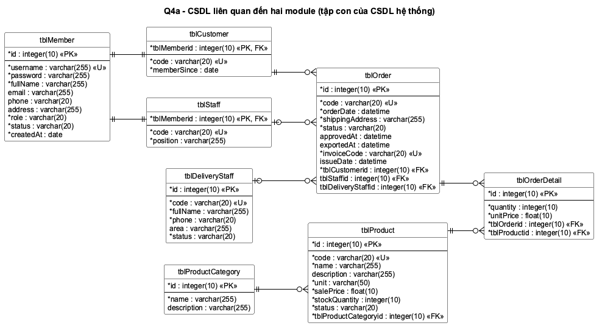

### 4b. Mã Java

Mã nguồn theo đúng thiết kế Q3b và CSDL hệ thống Q4a, tổ chức như giáo trình mục 5.1:
- [java/src/model/](java/src/model/): lớp thực thể (JavaBean).
- [java/src/dao/](java/src/dao/): lớp `DAO` cơ sở và các lớp `XxxDAO`.
- [java/WebContent/](java/WebContent/): trang JSP, gồm `gdLogin.jsp` / `doLogin.jsp`, thư mục `khachhang/` cho module 1 và `nhanvienbanhang/` cho module 2.
- [java/test/](java/test/): kiểm thử.

Mã dùng Java 17 và JSP chạy trên Tomcat 10 trở lên. Mặc định kết nối MySQL (`sql/system_schema.sql`); đổi bằng system property `deptstore.db.url`.

**Khung lớp thực thể** – thuộc tính private, mỗi thuộc tính có getter/setter. Ví dụ `Invoice`:

```java
package model;

public class Invoice {
    private int id;              // dùng chung id với Order (hóa đơn được gộp vào tblOrder)
    private String code;         // HD1024
    private Date issueDate;      // null khi đơn chưa xuất (hóa đơn chưa lập)
    private double totalAmount;  // dẫn xuất: tổng quantity x unitPrice của các dòng hàng
    private Order order;

    public Invoice() { super(); }
    public int getId() { return id; }
    public void setId(int id) { this.id = id; }
    // ... getter/setter cho mọi thuộc tính
}
```

**Lớp DAO cơ sở và một lớp DAO** (rút gọn; mã đầy đủ trong [java/src/dao/](java/src/dao/)) – mọi `XxxDAO` kế thừa `DAO` và dùng chung kết nối tĩnh `con`:

```java
public class DAO {
    public static Connection con;
    public DAO() {
        if (con == null) {
            con = DriverManager.getConnection(dbUrl, user, password);   // MySQL mặc định
        }
    }
}

public class OrderDAO extends DAO {
    public OrderDAO() { super(); }

    public boolean exportOrder(Order order) {          // một giao dịch (BR05)
        boolean kq = false;
        try {
            con.setAutoCommit(false);
            ProductDAO productDAO = new ProductDAO();
            if (productDAO.checkStock(order.getDetails())) {
                // UPDATE tblOrder SET status, tblStaffid, exportedAt
                //   WHERE id = ? AND status = 'APPROVED' AND tblDeliveryStaffid IS NOT NULL   (BR03, BR06)
                kq = updateOrder(order) == 1
                        && productDAO.decreaseStock(order.getDetails())
                        && new InvoiceDAO().issueInvoice(order);
            }
            if (kq) con.commit(); else con.rollback();
        } catch (Exception e) {
            con.rollback();
        } finally {
            con.setAutoCommit(true);
        }
        return kq;
    }
}
```

**Giải thích các phương thức**

| Lớp | Phương thức | Hoạt động |
|---|---|---|
| `DAO` | `DAO()` | Lần đầu tạo kết nối tĩnh `con`; các lớp con gọi `super()` nên dùng chung một kết nối. |
| `MemberDAO` | `checkLogin(username, password)` | Tìm thành viên đang hoạt động; trả về `Customer`, `SaleStaff` hoặc `Staff` theo `role` (kèm mã KH/NV), sai thì `null`. |
| `InvoiceDAO` | `getInvoiceByCustomer(idCustomer)` | Đọc các đơn của khách trong `tblOrder` (hóa đơn đã gộp), mới nhất trước. Tổng tiền tính bằng `SUM(quantity * unitPrice)`; nạp dòng hàng để hiển thị số mặt hàng. |
|  | `getInvoiceDetail(idInvoice, idCustomer)` | Điều kiện `o.id = ? AND o.tblCustomerid = ?` nên hóa đơn của khách khác trả về `null` (BR01). Kèm nhân viên giao hàng và các dòng hàng. |
|  | `issueInvoice(order)` | `UPDATE tblOrder SET issueDate = ? WHERE id = ? AND issueDate IS NULL`: chỉ lập một lần; chạy trong giao dịch của `exportOrder()`. |
| `OrderDAO` | `getUnexportedOrder()` | Đơn `PENDING` / `APPROVED` cũ nhất trước, kèm khách hàng, tổng tiền dẫn xuất và dòng hàng. |
|  | `approveOrder(order)` | Ghi trạng thái, nhân viên duyệt, thời điểm duyệt mà `doApproveOrder.jsp` đã set. Điều kiện `status = 'PENDING'` nên đơn đã hủy trả `false` (ngoại lệ 8). |
|  | `assignDeliveryStaff(order)` | Chỉ gán khi đơn `APPROVED` và nhân viên giao hàng không `INACTIVE`. |
|  | `exportOrder(order)` | Như đoạn mã trên. Mọi lỗi đều rollback toàn bộ nên không bao giờ trừ kho nửa chừng; điều kiện `status = 'APPROVED'` chặn xuất hai lần. |
| `OrderDetailDAO` | `getOrderDetailByOrder(idOrder)` | Dòng hàng kèm sản phẩm và tồn kho hiện tại; `lineAmount` tính khi đọc (không lưu). |
| `ProductDAO` | `checkStock(listDetail)` | So tồn kho hiện tại với số lượng đặt, ghi tồn kho mới đọc vào từng `Product` để giao diện báo thiếu. |
|  | `decreaseStock(listDetail)` | `UPDATE ... SET stockQuantity = stockQuantity - ? WHERE id = ? AND stockQuantity >= ?` cho từng dòng: không bao giờ trừ âm, kể cả khi hai giao dịch chạy cùng lúc. |
| `DeliveryStaffDAO` | `getAvailableDeliveryStaff()` | Nhân viên không `INACTIVE`, người sẵn sàng trước, kèm số đơn đang giao (`activeOrderCount`, dẫn xuất). |
| `gd*.jsp` | – | Kiểm tra phiên đăng nhập (hết phiên thì về `gdLogin.jsp?err=timeout`), gọi DAO, lưu đối tượng vào session, hiển thị. |
| `do*.jsp` | – | Set thuộc tính cho `Order`, gọi DAO lưu, thông báo kết quả (`alert`) rồi quay về `gdOrderDetail.jsp`. `doExportOrder.jsp` chọn thông báo theo ngoại lệ 16a / 16b / 16c. |

**Kiểm thử** (giáo trình mục 5.3). Chạy bằng `python3 verify.py`, hiện 26/26 ca đạt.

Kiểm thử đơn vị dùng JUnit, mỗi ca chạy trên một CSDL mới dựng từ `system_schema.sql` + `system_sample_data.sql` (tương đương rollback sau mỗi ca):

| TT | Chức năng | Lớp điều khiển | Phương thức | Trường hợp test |
|---|---|---|---|---|
| 1 | Theo dõi hóa đơn | InvoiceDAO | `getInvoiceByCustomer()` | KH có 3 hóa đơn (đúng thứ tự, trạng thái, số mặt hàng, tổng tiền); KH chưa có hóa đơn |
|  |  |  | `getInvoiceDetail()` | Hóa đơn của chính KH; hóa đơn của KH khác (BR01); hóa đơn không tồn tại |
|  |  |  | `issueInvoice()` | Lập lần đầu; lập lần hai bị từ chối |
| 2 | Duyệt và xuất đơn | OrderDAO | `getUnexportedOrder()` | 3 đơn chưa xuất với khách, số mặt hàng, tổng tiền, trạng thái |
|  |  |  | `approveOrder()` | Đơn chờ duyệt; đơn đã hủy (ngoại lệ 8) |
|  |  |  | `assignDeliveryStaff()` | Đơn chưa duyệt; nhân viên nghỉ việc; đơn đã duyệt + nhân viên hợp lệ |
|  |  |  | `exportOrder()` | Kịch bản chuẩn (tồn kho 38/115/50, Đã xuất, lập hóa đơn); xuất lần hai (16a); chưa phân công (16c); thiếu hàng (16b, không đổi gì) |
|  |  | OrderDetailDAO | `getOrderDetailByOrder()` | Đơn 3 dòng; đơn không tồn tại |
|  |  | ProductDAO | `checkStock()`, `decreaseStock()` | Đủ hàng; thiếu hàng; trừ đủ mọi dòng; từ chối trừ âm |
|  |  | DeliveryStaffDAO | `getAvailableDeliveryStaff()` | GH03 (1 đơn), GH05 (0), GH08 (3), không có GH09 |
| 3 | Đăng nhập | MemberDAO | `checkLogin()` | Khách hàng; nhân viên bán hàng; sai mật khẩu |

Ngoài ra, `webtest.WebFlowTest` chạy các trang JSP thật trong Tomcat nhúng và đi lại qua HTTP:
- toàn bộ kịch bản chuẩn của hai module;
- các ngoại lệ 8, 16a, 16b, 16c, 4a, 4b;
- truy cập khi chưa đăng nhập và sai mật khẩu.

Kiểm thử này đã phát hiện và giúp sửa một lỗi mã hóa ký tự ở tệp include dùng chung của JSP.

> Bản thử nghiệm cũ theo kiến trúc Servlet (trước khi chốt chấm theo CNPM 2020) được lưu ở [legacy/](legacy/), không còn được bảo trì.

---

## Question 5

### 5a. Biểu đồ gói

Theo giáo trình mục 4.3.3, lớp thực thể đặt trong gói `model`, lớp DAO trong gói `dao`, trang JSP trong gói `view`. Gói `view` chia nhỏ theo người dùng:
- `thanhvien`: `gdLogin.jsp`, `doLogin.jsp` (dùng chung cho mọi actor);
- `khachhang`: 3 trang của module 1;
- `nhanvienbanhang`: 5 trang `gd*.jsp` và 3 trang `do*.jsp` của module 2.

Gói `dao` gồm lớp cơ sở `DAO`, `MemberDAO` (đăng nhập) và 5 lớp DAO của hai module; gói `model` gồm 9 lớp thực thể. Mọi lớp trong hình đều có mã nguồn ở Q4b.

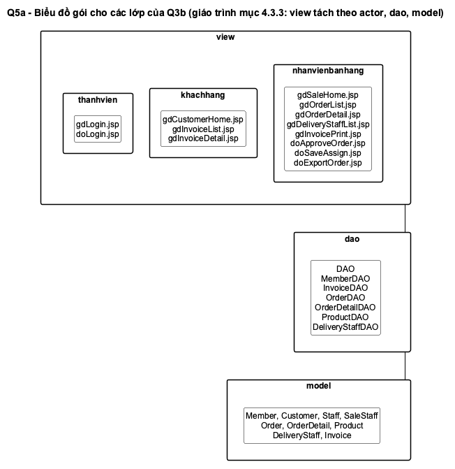

### 5b. Biểu đồ triển khai MVC trên J2EE

- **Máy khách**: trình duyệt nhận trang HTML do JSP sinh ra qua HTTP/HTTPS; in hóa đơn bằng lệnh in của trình duyệt.
- **Web Server**: Apache Tomcat 10+ (Jakarta EE; mã đã chạy kiểm thử trên Tomcat 11) chạy `deptstore.war`, bố trí đúng như thư mục `java/WebContent`:
  - **View**: `gdLogin.jsp`, `khachhang/gd*.jsp`, `nhanvienbanhang/gd*.jsp`;
  - **Controller**: `doLogin.jsp`, `nhanvienbanhang/do*.jsp` và gói `dao` trong `WEB-INF/classes` (giáo trình gọi lớp DAO là "lớp điều khiển");
  - **Model**: gói `model` trong `WEB-INF/classes`;
  - JDBC driver `mysql-connector-j.jar` trong `WEB-INF/lib`.
- **Database Server**: MySQL chứa CSDL 11 bảng của Q4a, kết nối qua JDBC (TCP 3306).

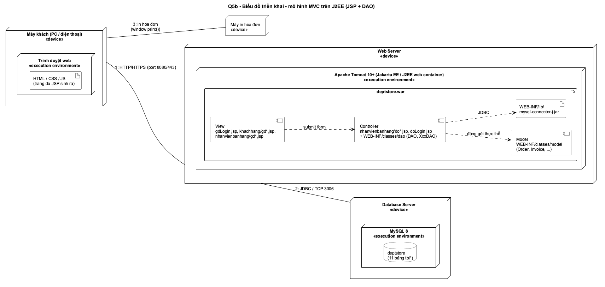

---

## Phụ lục – Phân tích hoạt động bổ sung

**Biểu đồ trạng thái (luồng giao diện).** Theo mục 3.2.4 của giáo trình, mỗi trạng thái là một lần hệ thống hiển thị một giao diện và chờ người dùng; điều kiện chuyển là hành động của người dùng trên giao diện đó.

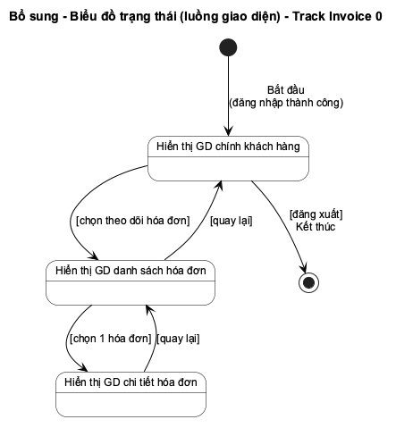

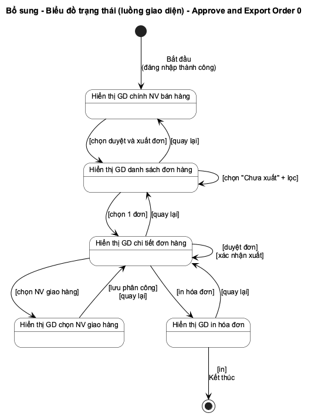

**Biểu đồ trạng thái của đối tượng Order.** Vòng đời của đơn hàng qua hai module; bản gốc có trạng thái `ReadyForExport` không có trong bảng trạng thái nên bản vẽ lại dùng đúng sáu trạng thái, việc "đã phân công" là điều kiện gác của `export()`.

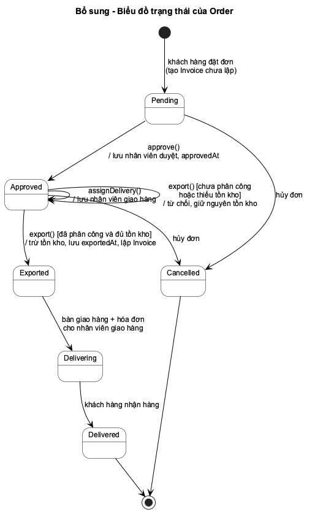

**Biểu đồ tuần tự phân tích** – bước 3 của giáo trình: chuyển biểu đồ giao tiếp thành biểu đồ tuần tự.

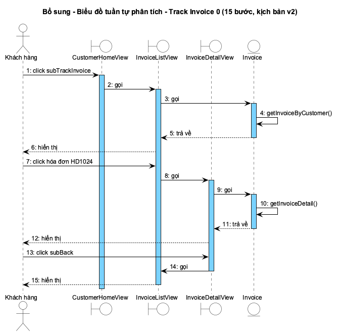

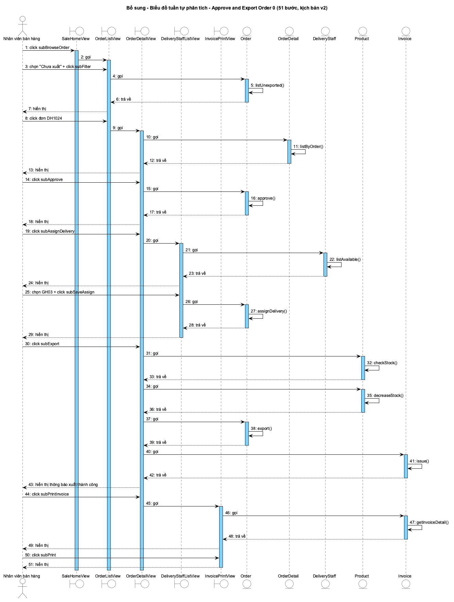

**Bản cũ theo kiến trúc Servlet** (đi kèm mã Java thử nghiệm cũ trong [legacy/](legacy/); không thuộc thiết kế CNPM 2020):
- biểu đồ lớp thiết kế: [z1](diagrams/src/z1-legacy-design-servlet-track-invoice.puml), [z2](diagrams/src/z2-legacy-design-servlet-approve-export.puml);
- CSDL hai module: [z3](diagrams/src/z3-legacy-database-modules.puml);
- biểu đồ giao tiếp mức thiết kế: [z4](diagrams/src/z4-legacy-communication-servlet-track-invoice.puml), [z5](diagrams/src/z5-legacy-communication-servlet-approve-export.puml).
